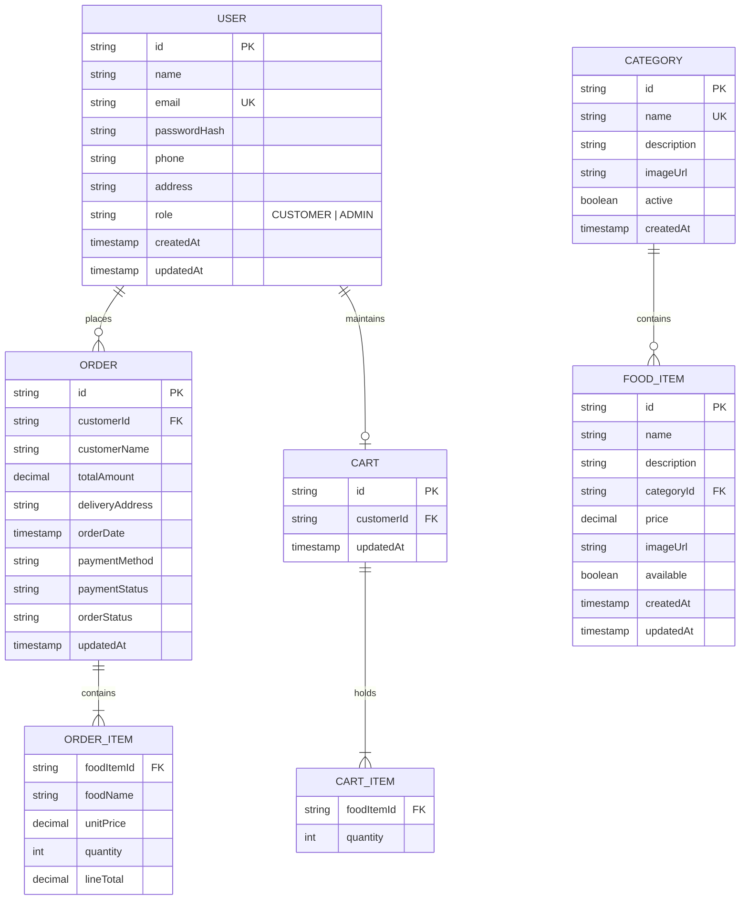
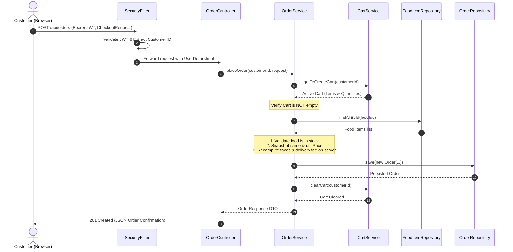
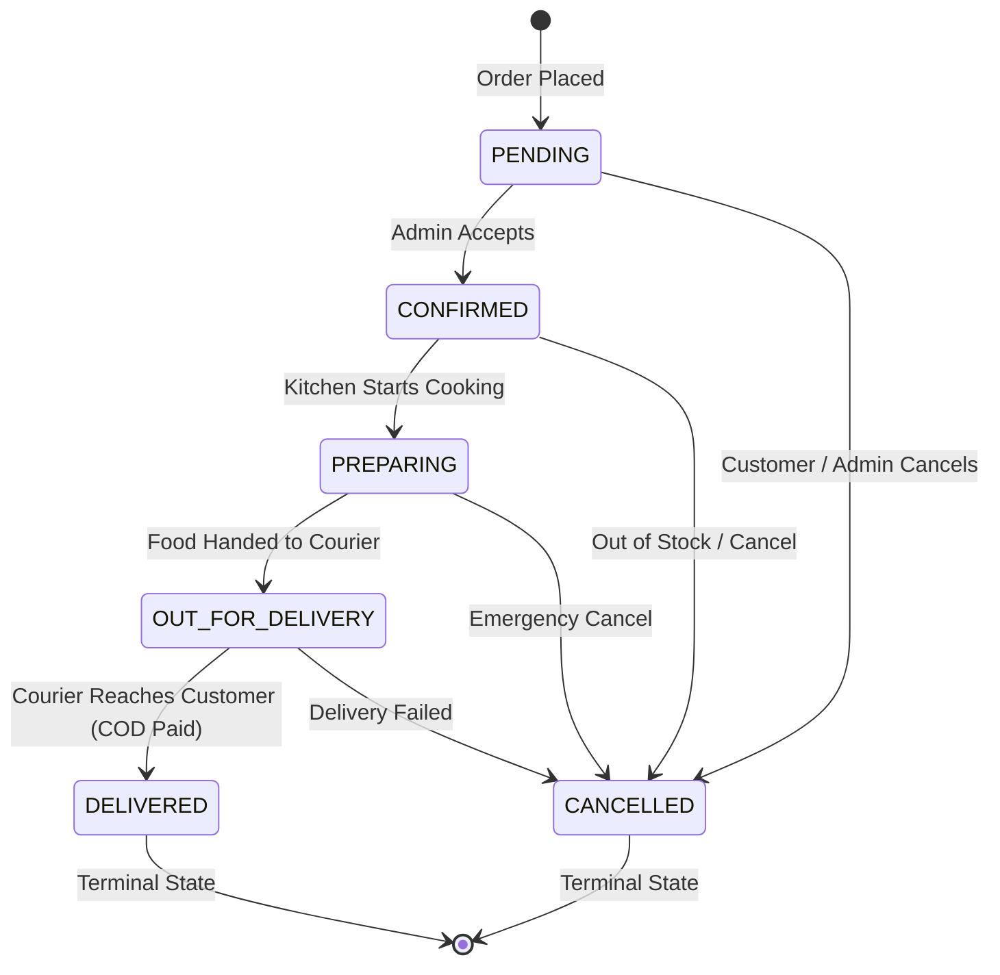

# 🎓 CraveBite — College Project Report & Viva Voce Guide

## Project Title: Online Food Ordering System — Full-Stack Web Application
**Domain:** Enterprise Web Applications, Software Architecture, RESTful API Services, Database Systems  
**Technologies:** Java 17+, Spring Boot 3.3.5, Spring Data MongoDB, Spring Security 6, Stateless JWT (JJWT 0.12.6), Vanilla HTML5/CSS3/JavaScript (ES6+)

---

## 1. Executive Summary

The **Online Food Ordering System** is a full-stack, enterprise-grade web application created to digitize the food ordering lifecycle for customers and restaurant management. The platform provides a seamless digital storefront for customers to browse dynamic menus, filter items, place orders with real-time recalculations, and track delivery progress. Simultaneously, restaurant managers have access to a secure, role-restricted dashboard with business analytics, menu inventory management, and enforced order fulfillment pipelines.

---

## 2. System Architecture & Diagrams

### 2.1 High-Level Architecture Flow

```mermaid
flowchart TD
    Client["Browser / Mobile Client (Vanilla JS / HTML5)"] -->|HTTP / JSON + Bearer JWT| Gateway["Spring Security Filter Chain"]
    Gateway -->|JWT Validation & Role Check| Controllers["REST Controllers (@RestController)"]
    Controllers -->|DTO Validation (@Valid)| Services["Service Layer (Business Logic & FSM)"]
    Services -->|Data Queries & Mutations| Repositories["Spring Data MongoDB Repositories"]
    Repositories -->|MongoDB Driver Wire Protocol| Database[("MongoDB Database (Atlas / Local)")]

    subgraph Security Layer
        AuthFilter["AuthTokenFilter"]
        JwtUtil["JwtUtils (HS256)"]
        SecConfig["SecurityFilterChain"]
    end
    Gateway -.-> AuthFilter
    AuthFilter -.-> JwtUtil
```

---

### 2.2 Entity-Relationship Diagram (Document Schema)



---

### 2.3 Order Placement Sequence Diagram



---

## 3. Order Status Finite State Machine (FSM)

The system enforces strict business state transitions so that orders cannot arbitrarily change state or revert once completed:



---

## 4. Key Design Patterns & Engineering Highlights

1. **Stateless JWT Pattern**: Scalable, session-less authentication using HMAC-SHA256 tokens passed via `Authorization: Bearer <token>`.
2. **Snapshot Pricing Pattern**: When an order is placed, food prices and dish names are copied into `OrderItem` documents. If restaurant prices change in the future, past order historical records and accounting remain intact.
3. **Server-Side Financial Integrity**: Frontend calculations are treated as untrusted hints. The backend queries MongoDB directly, recalculates line totals, checks order thresholds, applies tax rates, and validates free delivery discounts.
4. **Ownership Authorization Guard**: Customers can only inspect their own carts, profile, and orders. Attempts to access other customer order IDs trigger Spring Security `AccessDeniedException` (HTTP 403).
5. **No-Lombok Compatibility Architecture**: Uses standard Java 17 records and POJOs, eliminating javac compiler AST compatibility failures on modern JDK 21/25 environments.

---

## 5. Top 25 Viva Voce Questions & Answers

### General & Architecture
#### Q1: What is Spring Boot and why did you choose it over Spring MVC?
**Answer:** Spring Boot provides opinionated starter dependencies, auto-configuration, and an embedded servlet container (Tomcat). Unlike traditional Spring MVC with extensive XML or manual Java configurations, Spring Boot enables rapid, production-ready development with zero boilerplate and minimal configuration.

#### Q2: Why did you choose MongoDB instead of a relational database like MySQL?
**Answer:**
1. **Document Model Flexibility**: Food items often have varied attributes (toppings, spice levels, allergens) and order items naturally fit embedded document arrays (`items: [...]`).
2. **Horizontal Scalability**: MongoDB scales out natively via sharding.
3. **Fast Read/Write Performance**: High-concurrency menu lookups and order updates perform efficiently with MongoDB's BSON architecture and embedded document queries.

#### Q3: What is the purpose of the 3-tier architecture in this project?
**Answer:**
- **Controller Layer**: Handles HTTP requests, parameter validation (`@Valid`), and response mapping.
- **Service Layer**: Houses core business logic, status transitions, pricing calculations, and transaction coordination.
- **Repository Layer**: Handles persistence and queries against MongoDB documents.
This enforces separation of concerns, testability, and maintainability.

---

### Security & Authentication
#### Q4: How does JWT authentication work in your application?
**Answer:**
1. User submits email and password to `/api/auth/login`.
2. `AuthService` verifies credentials via `AuthenticationManager` and `BCryptPasswordEncoder`.
3. `JwtUtils` signs a token with HMAC-SHA256 containing claims (`userId`, `role`, `name`, `exp`).
4. On subsequent requests, the client sends `Authorization: Bearer <token>`.
5. `AuthTokenFilter` intercepts the request, validates the cryptographic signature, extracts the user details, and populates `SecurityContextHolder`.

#### Q5: Why is stateless authentication preferred over HTTP sessions for modern APIs?
**Answer:** Stateless authentication does not require storing session state in server memory. This enables horizontal scaling across multiple load-balanced server nodes without needing distributed session caches (like Redis) or sticky sessions.

#### Q6: How are passwords stored securely?
**Answer:** Passwords are hashed using BCrypt (`BCryptPasswordEncoder`). BCrypt includes a cryptographically random salt and a configurable work factor (iteration count), making it resilient against dictionary attacks and rainbow table lookups. Plaintext passwords and hashes are never exposed in API responses.

#### Q7: How do you prevent Customer A from viewing Customer B's order?
**Answer:** In `OrderService.getOrderById(...)`, the system compares the authenticated customer ID from the JWT (`userDetails.getId()`) with `order.getCustomerId()`. If they do not match and the user is not an administrator, the method throws an `AccessDeniedException`, resulting in an HTTP 403 Forbidden response.

#### Q8: How did you implement initial Admin user creation without committing hardcoded credentials?
**Answer:** We implemented `DataInitializer` (a `CommandLineRunner`), which reads `ADMIN_EMAIL` and `ADMIN_PASSWORD` from environment variables on startup. If provided and the user does not exist, it seeds the administrator account with a BCrypt hash. If no environment variables are provided, no default account is created.

---

### Business Logic & Data Handling
#### Q9: Why shouldn't we trust the total amount calculated by the frontend?
**Answer:** Clients can be manipulated via browser developer tools or raw API requests. A malicious user could tamper with the payload to order food for $0.01. The backend must always re-verify item availability, retrieve authentic unit prices from the database, and calculate subtotals, taxes, and shipping on the server.

#### Q10: What is the "Snapshot Pattern" in your Order entity?
**Answer:** If an item costs $12.00 today and increases to $15.00 next week, previous receipts should still reflect the original $12.00 price paid. We achieve this by snapshotting the food name and unit price directly into each `OrderItem` inside the `Order` document at checkout.

#### Q11: How do you handle order status updates and prevent invalid transitions?
**Answer:** In the `OrderStatus` enum, we implemented a state-machine method `canTransitionTo(OrderStatus next)`. For example, `PENDING` can transition to `CONFIRMED` or `CANCELLED`, but `DELIVERED` is a terminal state and cannot be transitioned back to `PENDING`. Invalid transitions throw `InvalidStatusTransitionException` (HTTP 400).

#### Q12: How are monetary values represented and why?
**Answer:** All monetary figures use `java.math.BigDecimal` with explicit rounding modes (`RoundingMode.HALF_UP`). Using `float` or `double` for currency causes binary floating-point representation errors (e.g., `0.1 + 0.2 = 0.30000000000000004`).

---

### Frontend & Integration
#### Q13: Why did you use Vanilla JavaScript instead of React or Angular?
**Answer:**
- Zero build complexity: No Node/Webpack/Vite tooling needed to serve static assets; Spring Boot serves them natively from `classpath:/static/`.
- Lightweight & instant loading: Vanilla JS ES6 modules load with zero bundle overhead.
- Universal compatibility: Standard Web APIs (`fetch`, `localStorage`, `DOM`) work in any modern browser.

#### Q14: How does the client keep track of the shopping cart count in the navbar?
**Answer:** `main.js` provides `refreshCartCount()`. On initial page load or whenever an item is added, updated, or removed, it invokes `api.cart.get()` and updates the DOM badge `#nav-cart-count`.

#### Q15: How does the live order tracking feature work?
**Answer:** `order-tracking.html` queries `/api/orders/{id}` and maps the current `OrderStatus` to a 5-step visual stepper. Completed steps display a checkmark, the active step is highlighted with an animated ring, and future steps remain muted.

---

### Testing & Deployment
#### Q16: How did you test the backend without requiring a live MongoDB instance?
**Answer:** Unit tests use Mockito (`@Mock`, `@InjectMocks`) to mock repository responses, and controller tests use standalone `MockMvc`. This verifies HTTP status codes, validation constraints, and business logic without external database dependencies.

#### Q17: How did you resolve Mockito dynamic agent loading issues in modern JDK versions?
**Answer:** In JDK 21+ and JDK 25, dynamic bytecode instrumentation requires JVM authorization. We configured `maven-surefire-plugin` with:
`<argLine>-XX:+EnableDynamicAgentLoading -Dnet.bytebuddy.experimental=true</argLine>`.

#### Q18: How is the application prepared for cloud deployment (e.g. Render, Heroku)?
**Answer:** `application.properties` maps the port dynamically using `server.port=${PORT:${SERVER_PORT:8080}}` so the app binds to the cloud provider's injected port. Database settings use `spring.data.mongodb.uri=${MONGODB_URI:...}` to connect to MongoDB Atlas.

---

## 6. Project Checklist for Viva Day

- [x] Spring Boot backend builds cleanly with `./mvnw package`
- [x] All 28 automated tests pass (`BUILD SUCCESS`)
- [x] Docker Compose configured for local MongoDB
- [x] Postman API collection available for live demonstration
- [x] Initial admin credentials seeded through environment variables
- [x] Customer registration, cart, checkout, and tracking verified
- [x] Admin dashboard analytics and catalog mutations verified
- [x] Architectural diagrams and viva answers documented
